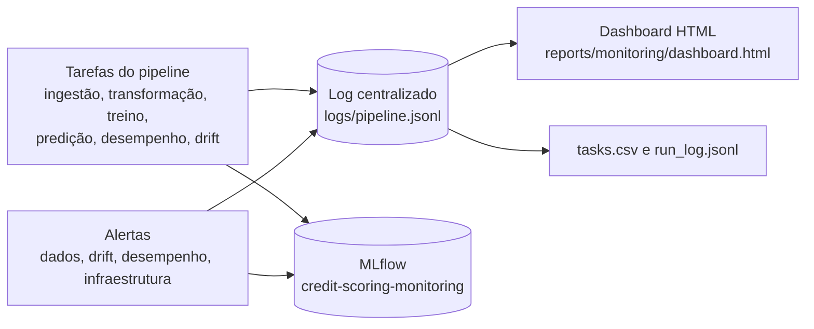
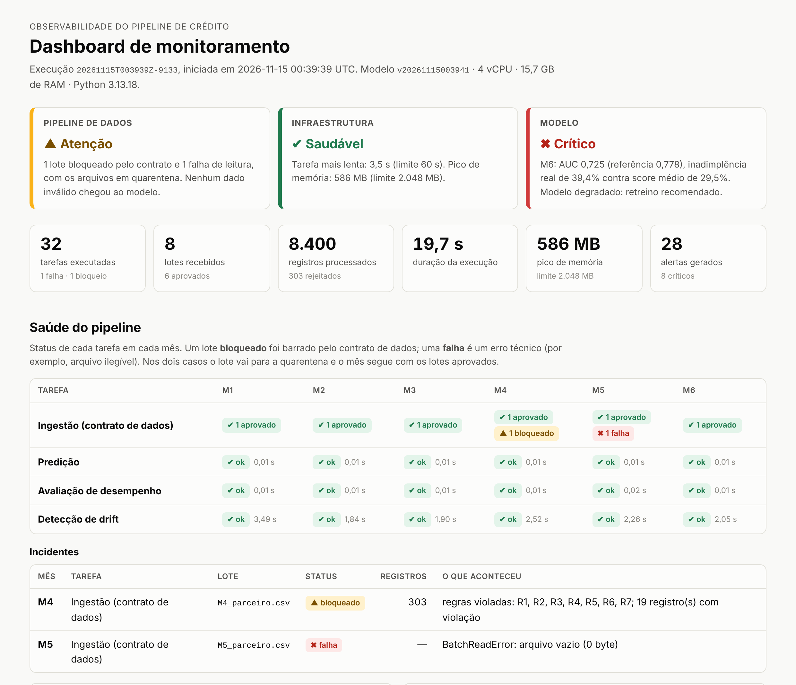
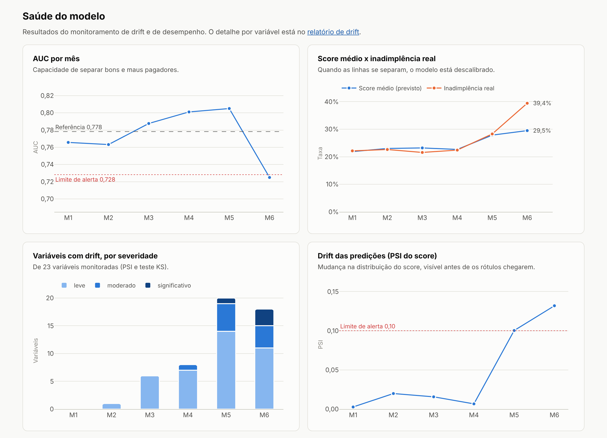

# Tech Challenge Fase 4 — Sustentação e Confiabilidade de um Modelo de Credit Scoring

> **Tema:** Observabilidade Contínua, Detecção de Drift, Qualidade de Dados e Governança em Produção

Uma fintech de crédito tem um modelo de *Credit Scoring* em produção. Com mudanças recentes na economia
(inflação, novos perfis de clientes), há suspeita de que o modelo esteja sofrendo **degradação silenciosa**.
Este projeto constrói a camada de sustentação e confiabilidade desse modelo:

1. **Contratos de dados** que impedem a entrada de dados ruins no modelo (Pandera).
2. **Simulação e detecção de drift** de dados e de conceito ao longo do tempo (Evidently AI, PSI, KS).
3. **Observabilidade** do pipeline, da infraestrutura e do modelo (logs estruturados, MLflow, dashboard).
4. **Governança e LGPD**, com análise causal da degradação.

## Status

| Etapa | Descrição | Status |
|---|---|---|
| 0 | Fundação do projeto (estrutura, dependências, ingestão do dataset) | concluída |
| 1 | Validação de dados e contratos + modelo baseline | concluída |
| 2 | Simulação e detecção de drift | concluída |
| 3 | Observabilidade de pipelines e modelos | concluída |
| 4 | Governança, LGPD e causalidade | pendente |
| 5 | Entrega final (README consolidado, CI, vídeo) | pendente |

## Dataset

**Default of Credit Card Clients** (UCI, 30.000 clientes, CC BY 4.0). Fonte, dicionário de dados e problemas
de qualidade encontrados estão em [`data/README.md`](data/README.md).

## Como executar

Requer **Python 3.12 ou superior** e `make`.

```bash
make setup
```

```bash
make all
```

`make all` roda o pipeline de ponta a ponta com observabilidade (`make pipeline`) e, em seguida, a
demonstração do contrato. Ao final, abra `reports/monitoring/dashboard.html`. Cada passo também pode ser
rodado isoladamente:

| Comando | O que faz |
|---|---|
| `make data` | Garante o dataset bruto e verifica sua integridade (SHA-256) |
| `make prepare` | Limpa, pseudonimiza e separa Referência x Pool de Produção |
| `make contract-demo` | Aprova um lote válido e bloqueia um lote corrompido |
| `make validate BATCH=arquivo.csv` | Valida um lote qualquer contra o contrato |
| `make train` | Treina os modelos e registra no MLflow |
| `make simulate` | Simula 6 meses de produção com drift crescente |
| `make drift` | Monitora os meses: contrato, predição, drift, desempenho e alertas |
| `make pipeline` | Executa tudo acima em uma única execução rastreada: log central, MLflow e dashboard |
| `make dashboard` | Regera o dashboard a partir do log centralizado |
| `make mlflow-ui` | Abre a interface do MLflow em http://127.0.0.1:5000 |
| `make test` / `make lint` | Testes automatizados e verificação de estilo |

## Etapa 1 — Validação de dados e contratos

### Preparação dos dados

O dado bruto passa por uma preparação documentada antes de qualquer uso
(`src/credit_monitoring/data/prepare.py`):

| Tratamento | Registros | Motivo |
|---|---|---|
| `education` 0, 5 e 6 → 4 ("outros") | 345 | Códigos não documentados ou "desconhecido" na fonte |
| `marriage` 0 → 3 ("outros") | 54 | Código não documentado na fonte |
| Remoção de registros idênticos | 35 | Não trazem informação nova e, divididos entre treino e teste, inflariam as métricas |
| Pseudonimização do `ID` | todos | HMAC-SHA256 com chave secreta mantida fora do repositório (LGPD, art. 13, §4º) |

Em seguida, o dataset é dividido **uma única vez**, de forma estratificada e com semente fixa:

| Camada | Registros | Inadimplência | Uso |
|---|---|---|---|
| Referência | 20.975 | 22,13% | Único dataset usado no treino |
| Pool de Produção | 8.990 | 22,12% | Nunca visto no treino; base dos lotes onde o drift vai acontecer |

### Contrato de dados (Pandera)

Todo lote passa por um **gate de ingestão** (`src/credit_monitoring/contracts/`). Se uma regra rígida
for violada, o lote **inteiro** é bloqueado e copiado para `data/quarantine/`, com relatório em HTML e
JSON. Pela linha de comando, o processo termina com código de saída 1.

| ID | Regra | Tipo |
|---|---|---|
| R1 | Schema estrito: colunas obrigatórias, sem colunas extras (evita vazamento de dados como CPF), tipos numéricos válidos | rígida |
| R2 | Sem valores nulos | rígida |
| R3 | Idade entre 18 e 100 anos | rígida |
| R4 | Limite de crédito maior que zero e até 5.000.000 | rígida |
| R5 | Domínios válidos: sexo, escolaridade, estado civil, status de pagamento (-2 a 9) e alvo | rígida |
| R6 | Valores pagos não negativos | rígida |
| R7 | Sem duplicatas: `client_id` único e nenhum registro reenviado | rígida |
| W1 | Fatura negativa (saldo credor) | alerta |
| W2 | Fatura mais recente acima de 1,5x o limite | alerta |

Os limites descrevem o que é **plausível para o negócio**, e não a distribuição do treino. Assim, um
lote com drift (ex.: limites maiores por inflação) continua válido: mudança de distribuição é papel do
monitoramento de drift (Etapa 2), não do contrato.

As checagens convertem o valor para número antes de comparar. Sem isso, um único texto inválido numa
coluna impediria o Pandera de checar os outros valores dela e esconderia outras violações.

**Demonstração** (`make contract-demo`): dois lotes de 500 registros chegam como CSV em `data/incoming/`.

| Lote | Resultado | Relatório |
|---|---|---|
| Válido | Aprovado, com alertas W1 (36 registros) e W2 (2) | [`reports/validation/lote_valido.html`](reports/validation/lote_valido.html) |
| Corrompido (erros injetados para cada regra) | **Bloqueado**: R1 a R7 detectadas, 19 registros com violação | [`reports/validation/lote_corrompido.html`](reports/validation/lote_corrompido.html) |

### Modelo baseline

Dois candidatos treinados na Referência (64% treino, 16% validação, 20% teste). O campeão e o limiar de
decisão são escolhidos **só na validação**; o teste serve apenas para reportar o desempenho final.

| Candidato | AUC validação | AUC teste | KS | Gini | F1 | Recall | Precisão |
|---|---|---|---|---|---|---|---|
| Regressão Logística | 0,745 | 0,726 | 0,386 | 0,451 | 0,515 | 0,490 | 0,542 |
| **XGBoost (campeão)** | **0,788** | **0,778** | **0,436** | **0,557** | **0,532** | **0,560** | **0,506** |

- **Limiar de decisão:** 0,275 (máximo F1 na validação), coerente com a taxa de inadimplência de ~22%.
- **Atributos fora do modelo:** `sex` e `marriage`, por minimização e não discriminação (LGPD, art. 6º,
  III e IX). Eles continuam no dataset apenas para a auditoria de vieses da Etapa 4.
- **Rastreamento:** os dois candidatos ficam registrados no MLflow; o campeão vai para o Model Registry
  como `credit-scoring-model` com o alias `champion`. Cada modelo é salvo no seu formato nativo e
  seguro, sem *pickle*: XGBoost em JSON/UBJ e scikit-learn via skops.
- **Metadados** do modelo (features, limiar, métricas, impressão digital dos dados e versões das
  bibliotecas) em [`models/model_metadata.json`](models/model_metadata.json).

## Etapa 2 — Simulação e detecção de drift

### Simulação da passagem do tempo (`make simulate`)

Seis lotes mensais de 1.400 clientes são amostrados do **Pool de Produção** (nunca visto no treino) e
transformados segundo um cenário econômico que piora mês a mês. Os cenários ficam declarados em
`config/settings.yaml` (seção `simulation`) e cada mecanismo é separado, para que a análise causal da
Etapa 4 consiga medir o efeito de cada um:

| Mês | Cenário | O que muda nos dados | Inadimplência real |
|---|---|---|---|
| M1 | Estável (controle) | Nada: prova que o monitoramento não gera falso alarme | 22,1% |
| M2 | Início da inflação | Faturas +10% | 22,6% |
| M3 | Inflação persistente | Faturas +20%; pagamentos não acompanham | 21,6% |
| M4 | Novos perfis | Faturas +25%, limites +20%, 45% de clientes até 28 anos; **um parceiro envia um lote corrompido** | 22,4% |
| M5 | Desemprego em alta | Tudo acima + 12% da carteira passa a atrasar e pagamentos caem 10%; **o arquivo de um parceiro chega vazio** | 28,3% |
| M6 | Crise | Efeitos intensificados + **concept drift**: clientes em dia, porém muito endividados, passam a inadimplir sem mudar nenhuma variável | 39,4% |

Os rótulos seguem o mecanismo: inflação, limites e perfis mantêm o rótulo original (o risco real não
muda). No desemprego, o rótulo é sorteado com a taxa de inadimplência da Referência para o novo atraso,
preservando a relação que o modelo aprendeu. No concept drift, só o rótulo muda. Os lotes chegam sem o
alvo em `data/incoming/`; os rótulos, conhecidos só depois em produção, ficam em
`data/production/labels/`.

### Detecção (`make drift`)

Cada mês passa por: **gate de ingestão** (contrato da Etapa 1) → **predição** → **data drift** →
**prediction drift** → **desempenho** (com os rótulos) → **alertas**. A base de comparação é o conjunto de
teste da Referência: mesma distribuição do treino, mas fora do ajuste do modelo, então seus scores não
têm o viés otimista de dados de treino.

Cada variável recebe dois testes, que se complementam:

| Teste | Mede | Ferramenta | Limiar |
|---|---|---|---|
| **PSI** com faixas pelos decis da referência | Tamanho da mudança | implementação própria (`drift/stats.py`) | 0,10 moderado · 0,25 significativo |
| **Kolmogorov-Smirnov** | Se a mudança é estatisticamente significativa | Evidently AI (`DataDriftPreset`, método `ks`) | p-valor < 0,01 |

- **Por que PSI próprio:** o PSI do Evidently usa faixas de largura igual. Em variáveis de cauda longa,
  como faturas, quase todos os valores caem na primeira faixa e uma inflação de 30% gerava PSI de apenas
  0,055. Faixas por decis são o padrão em risco de crédito.
- **Por que α = 0,01 no KS:** com 23 testes por mês, α = 0,05 gerou algum falso positivo em 33% de 30
  meses simulados sem drift; com 0,01, em 3%.
- **Severidade:** *significativo* (PSI ≥ 0,25), *moderado* (PSI ≥ 0,10) ou *leve*, quando só o KS detecta
  a mudança. O nível leve funciona como detecção precoce, antes de o PSI subir.

### Resultados

| Mês | Variáveis com drift | Principais | PSI do score | AUC | Score médio | Inadimplência real | Alertas |
|---|---|---|---|---|---|---|---|
| M1 | 0/23 | — | 0,003 | 0,766 | 21,9% | 22,1% | 0 |
| M2 | 1/23 (leve) | `bill_amt_1` | 0,020 | 0,763 | 23,0% | 22,6% | 1 |
| M3 | 6/23 (leve) | `bill_amt_1..6` | 0,016 | 0,788 | 23,2% | 21,6% | 1 |
| M4 | 8/23 | `age` (moderado) | 0,007 | 0,801 | 22,7% | 22,4% | 4 |
| M5 | 20/23 | `pay_status_2` (significativo), `pay_status_1`, `pay_status_3`, `age` | 0,100 | 0,805 | 27,9% | 28,3% | 10 |
| M6 | 18/23 | `pay_status_2`, `pay_amt_1`, `pay_status_1` (significativos) | 0,132 | **0,725** | 29,5% | **39,4%** | 12 |

O que os resultados mostram:

1. **Sem falso alarme:** M1 não acusa drift em nenhuma variável.
2. **Detecção precoce:** a inflação de 10% em M2 já aparece no KS, mesmo com PSI baixo.
3. **Data drift nem sempre degrada o modelo:** em M4 e M5 a distribuição muda bastante, mas o AUC se
   mantém e o score médio acompanha a inadimplência real (27,9% x 28,3% em M5). O modelo ainda acerta.
4. **Concept drift degrada, e o score sozinho não mostra o tamanho do problema:** em M6 o AUC cai 0,053
   (alerta crítico) e o modelo **subestima o risco em 10 pontos** (29,5% previsto x 39,4% real).
5. **O contrato continua atuando em produção:** o lote corrompido do parceiro em M4 é bloqueado e vai
   para a quarentena, gerando alerta crítico de qualidade de dados. Em M5, o arquivo vazio do parceiro
   também vai para a quarentena, com alerta crítico de pipeline, e o mês segue com o lote válido.

### Relatórios gerados (`reports/drift/`)

| Arquivo | Conteúdo |
|---|---|
| [`drift_report.html`](reports/drift/drift_report.html) | **Relatório consolidado:** linha do tempo, mapa de PSI por variável e mês, AUC e calibração ao longo do tempo e alertas |
| `evidently_M1.html` … `evidently_M6.html` | Relatórios do Evidently por mês: drift por variável (KS) e desempenho de classificação |
| `feature_drift.csv` | PSI, p-valor do KS e severidade de cada variável em cada mês |
| `monthly_summary.csv` | Resumo mensal: drift, score, desempenho e alertas |
| `alerts.json` | Todos os alertas, com categoria, severidade, valor e limiar |

Os lotes mensais também geram relatório de validação do contrato em `reports/validation/` (incluindo
`M4_parceiro.html`, o lote bloqueado).

## Etapa 3 — Observabilidade de pipelines e modelos

`make pipeline` executa tudo em uma única execução identificada por um `run_id`. Cada tarefa é medida, e
todos os eventos vão para o mesmo lugar. A partir daí saem três visões da mesma execução:



### Log centralizado

Todas as etapas escrevem em `logs/pipeline.jsonl`: uma linha JSON por evento, sempre com o `run_id`
(`src/credit_monitoring/monitoring/logger.py`). Os resultados do monitoramento de drift vão para o mesmo
arquivo que os logs de execução, então uma única consulta responde "o que aconteceu nesta execução?".

| Evento | Quando | Campos principais |
|---|---|---|
| `run_started` / `run_finished` | Início e fim da execução | status, duração, tarefas, falhas, bloqueios, registros, pico de memória |
| `task_finished` | Fim de cada tarefa | tarefa, mês, lote, status, duração, CPU, memória, registros de entrada, saída e rejeitados |
| `baseline_referencia` | Carga do modelo | versão do modelo e métricas de referência |
| `resumo_mensal` | Fim de cada mês | variáveis com drift, PSI, AUC, score médio, inadimplência real, alertas |
| `alerta` | Cada alerta gerado | mês, categoria, severidade, valor e limiar |

Exemplo (o lote corrompido do parceiro sendo barrado em M4):

```json
{"ts": "2026-11-15T00:39:51.681+00:00", "level": "WARNING", "run_id": "20261115T003939Z-9133",
 "event": "task_finished", "task": "ingestao", "month": "M4", "batch": "M4_parceiro.csv",
 "status": "bloqueado", "duration_seconds": 0.0822, "memory_rss_mb": 538.2,
 "rows_in": 303, "rows_out": 0, "rows_rejected": 303,
 "detail": "regras violadas: R1, R2, R3, R4, R5, R6, R7; 19 registro(s) com violação"}
```

- **Sem dados pessoais:** o log guarda só contagens, métricas e nomes de arquivos. Um teste automatizado
  verifica que nenhum `client_id` aparece nele.
- **Severidade do alerta vira nível do log:** crítico = `ERROR`, atenção = `WARNING`, informativo = `INFO`.
- O arquivo `logs/` não é versionado; a cópia da última execução fica em
  [`reports/monitoring/run_log.jsonl`](reports/monitoring/run_log.jsonl) (89 eventos).

### Tarefas e tratamento de falhas

Cada tarefa roda dentro de `track_task` (`monitoring/telemetry.py`), que mede duração, tempo de CPU e
memória do processo (`psutil`) e registra o resultado com um de três status:

| Status | Significado | O que o pipeline faz |
|---|---|---|
| `sucesso` | Tarefa concluída | Segue adiante |
| `bloqueado` | O contrato de dados barrou o lote | Lote vai para a quarentena, alerta crítico de qualidade de dados, o mês segue com os lotes aprovados |
| `falha` | Erro técnico (ex.: arquivo vazio ou ilegível) | Em lote de ingestão: quarentena, alerta crítico de pipeline e o mês segue. Em qualquer outra tarefa: a execução é interrompida, registrada como `falha`, e o dashboard é gerado mesmo assim |

A simulação exercita os dois casos de ingestão: em M4 o parceiro envia dados inválidos (`bloqueado`) e em
M5 envia um arquivo vazio (`falha`). Nos dois, nenhum dado inválido chega ao modelo.

### Métricas de saúde operacional

| Métrica | O que mede | Onde aparece | Gera alerta quando |
|---|---|---|---|
| Status da tarefa | Sucesso, bloqueio ou falha de cada tarefa, por mês | Grade de status do dashboard, `tasks.csv` | Uma falha fora da ingestão interrompe a execução, que fica registrada como `falha` |
| Duração da tarefa | Latência de cada etapa, em segundos | Dashboard, MLflow (`duration_seconds`) | Passa de 60 s (`max_task_seconds`) |
| Latência da predição | Milissegundos para pontuar 1.000 registros | Dashboard, MLflow (`prediction_seconds`) | — |
| Registros recebidos, processados e rejeitados | Volume de dados por mês | Dashboard, MLflow (`rows_*`) | — (a rejeição já gera o alerta do lote, na linha abaixo) |
| Lotes bloqueados e com falha | Incidentes de ingestão | Dashboard, MLflow (`blocked_batches`, `failed_batches`) | Qualquer ocorrência (crítico) |
| Memória do processo | Uso de memória (RSS) ao fim de cada tarefa | Dashboard, MLflow (`memory_rss_mb`) | Passa de 2.048 MB (`max_memory_mb`) |
| Tempo de CPU | Processamento consumido por tarefa | Tabela de infraestrutura do dashboard | — |
| Variáveis com drift e PSI máximo | Mudança na distribuição dos dados | Dashboard, MLflow (`n_drifted`, `drift_share`, `psi_max`, `psi_<variável>`) | PSI ≥ 0,10 (atenção) ou ≥ 0,25 (crítico); 30% das variáveis com drift |
| PSI do score | Mudança na distribuição das predições, antes de os rótulos chegarem | Dashboard, MLflow (`prediction_psi`) | PSI ≥ 0,10 |
| AUC, KS e recall | Desempenho do modelo com os rótulos | Dashboard, MLflow | AUC cai 0,05 ou recall cai 0,10 em relação à referência |
| Diferença de calibração | Inadimplência real menos score médio | Dashboard, MLflow (`calibration_gap`) | Diferença de 5 pontos percentuais |
| Quantidade de alertas | Total e críticos, por mês e categoria | Dashboard, MLflow (`n_alerts`, `n_critical_alerts`) | — |

Os limites ficam em `config/settings.yaml` (seções `observability` e `drift`).

**O que fazer em cada alerta:**

| Categoria | Ação recomendada |
|---|---|
| Qualidade de dados (lote bloqueado) | Abrir o relatório em `reports/validation/`, acionar a origem do lote e reprocessar após a correção. O arquivo original fica em `data/quarantine/` |
| Pipeline (falha de ingestão) | Verificar a transferência do arquivo com a origem e solicitar o reenvio |
| Data drift | Investigar a causa no relatório de drift. Se o desempenho se mantém, acompanhar; se o drift é significativo em variáveis importantes, antecipar a revisão do modelo |
| Prediction drift | Sinal precoce, visível antes dos rótulos: reforçar o acompanhamento das decisões e antecipar a coleta de rótulos |
| Desempenho | Retreinar o modelo com dados recentes e rever o limiar de decisão. Enquanto isso, adotar política de crédito mais conservadora |
| Infraestrutura | Verificar volume de dados e recursos da máquina; ajustar os limites se o crescimento for esperado |

### Dashboard de monitoramento

[`reports/monitoring/dashboard.html`](reports/monitoring/dashboard.html) é um arquivo único que abre
offline. Ele é montado só a partir do log centralizado e mostra a execução mais recente:

- **Semáforo de saúde** em três frentes: pipeline de dados, infraestrutura e modelo.
- **Saúde do pipeline:** status de cada tarefa em cada mês, incidentes, volume aprovado e rejeitado e
  duração por etapa.
- **Infraestrutura:** duração, CPU, memória e vazão por tarefa; memória e latência de predição por mês.
- **Saúde do modelo:** AUC, calibração, variáveis com drift por severidade e PSI do score.
- **Alertas** por mês, severidade e categoria, e **histórico das últimas execuções**.





Na execução versionada (`20261115T003939Z-9133`):

| Indicador | Valor |
|---|---|
| Tarefas executadas | 32 (1 falha e 1 bloqueio, ambos de ingestão e tratados) |
| Registros processados / rejeitados | 8.400 / 303 |
| Duração da execução | 19,7 s (as duas anteriores levaram 19,1 s e 20,8 s) |
| Tarefa mais lenta | Detecção de drift, 3,5 s (média de 2,3 s por mês) |
| Latência da predição | 8 a 10 ms por 1.000 registros |
| Pico de memória | 586 MB (limite de 2.048 MB) |
| Alertas | 28, sendo 8 críticos |
| Semáforo | Pipeline em atenção (incidentes tratados), infraestrutura saudável, **modelo crítico** em M6 |

### Rastreamento no MLflow

Cada execução também é registrada no experimento `credit-scoring-monitoring` (`monitoring/tracking.py`):

- **Run pai** (`pipeline-<run_id>`): cada métrica é gravada com `step` igual ao número do mês, o que gera
  na interface os gráficos de evolução abaixo.
- **Runs filhos**, um por mês: métricas do mês, PSI de cada variável, relatório do Evidently e alertas
  como artefatos.

O treino continua no experimento `credit-scoring-training`, com o modelo campeão no Model Registry.
Para explorar: `make mlflow-ui`. A telemetria de uso do MLflow fica desativada, então nada sai do ambiente.


### Arquivos gerados (`reports/monitoring/`)

| Arquivo | Conteúdo |
|---|---|
| [`dashboard.html`](reports/monitoring/dashboard.html) | Dashboard de monitoramento da última execução |
| [`tasks.csv`](reports/monitoring/tasks.csv) | Métricas de cada tarefa: status, duração, CPU, memória e volumes |
| [`run_log.jsonl`](reports/monitoring/run_log.jsonl) | Todos os eventos do log centralizado da execução |

## Estrutura

```
├── config/settings.yaml        # configuração central (caminhos, sementes, limites, modelo)
├── data/                       # raw (versionado) e camadas geradas
├── docs/img/                   # capturas de tela usadas neste README
├── logs/                       # log centralizado do pipeline (não versionado)
├── models/                     # metadados do modelo (o binário é gerado por make train)
├── reports/
│   ├── validation/             # relatórios do contrato de dados (HTML + JSON)
│   ├── drift/                  # relatórios de drift (Evidently, consolidado, CSVs e alertas)
│   └── monitoring/             # dashboard, métricas por tarefa e log da última execução
├── src/credit_monitoring/
│   ├── data/                   # ingestão, limpeza, pseudonimização e separação
│   ├── contracts/              # contrato Pandera, gate de ingestão e relatórios
│   ├── models/                 # treino, métricas e artefato do modelo
│   ├── drift/                  # simulação de produção, PSI/KS, monitoramento e relatório
│   ├── monitoring/             # log central, telemetria, alertas, MLflow e dashboard
│   ├── pipeline.py             # orquestração de ponta a ponta com observabilidade
│   └── reporting.py            # estilo e gráficos compartilhados pelos relatórios HTML
├── tests/                      # testes automatizados (pytest)
├── Makefile                    # atalhos de execução
├── requirements.txt            # dependências de execução (versões fixas)
└── requirements-dev.txt        # dependências de desenvolvimento
```
