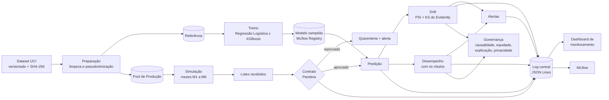
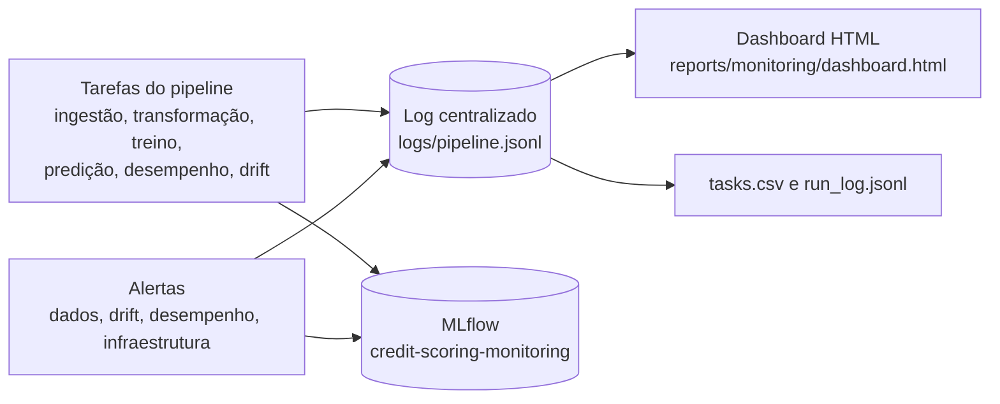
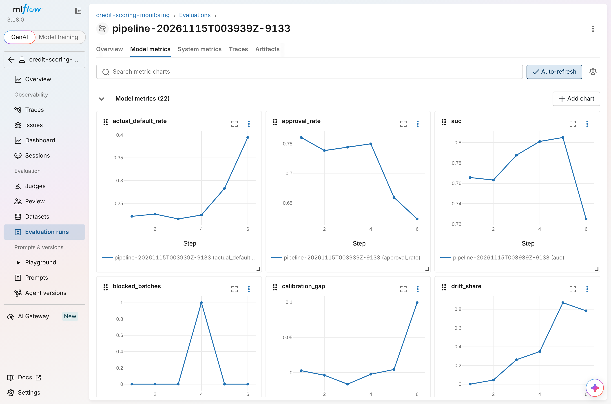
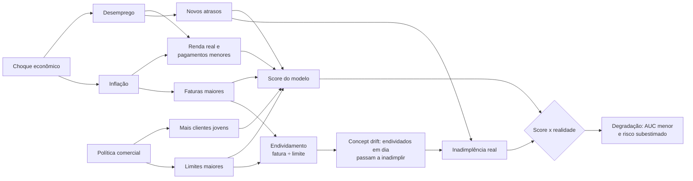
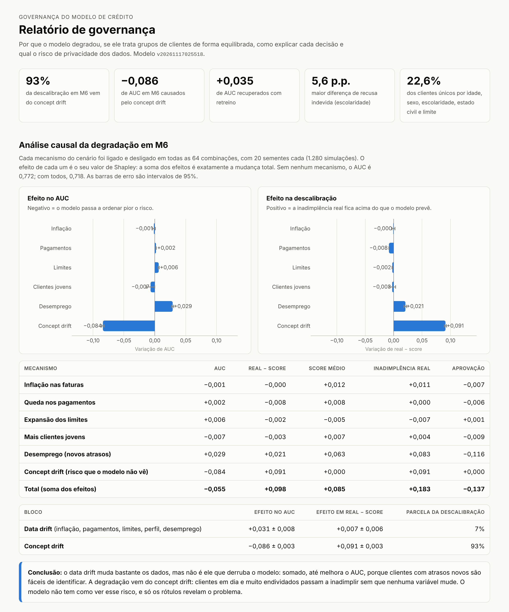

# Tech Challenge Fase 4 — Sustentação e Confiabilidade de um Modelo de Credit Scoring

[](https://github.com/Ahmedntc/Tech-ChallengeFase04/actions/workflows/ci.yml)

> **Tema:** Observabilidade Contínua, Detecção de Drift, Qualidade de Dados e Governança em Produção

Uma fintech de crédito tem um modelo de *Credit Scoring* em produção. Com mudanças recentes na economia
(inflação, novos perfis de clientes), há suspeita de que o modelo esteja sofrendo **degradação silenciosa**.
Este projeto constrói a camada de sustentação e confiabilidade desse modelo:

1. **Contratos de dados** que impedem a entrada de dados ruins no modelo (Pandera).
2. **Simulação e detecção de drift** de dados e de conceito ao longo do tempo (Evidently AI, PSI, KS).
3. **Observabilidade** do pipeline, da infraestrutura e do modelo (logs estruturados, MLflow, dashboard).
4. **Governança e LGPD**, com análise causal da degradação.

**Vídeo de apresentação (STAR, até 5 minutos):** _link a ser adicionado_ ·
[roteiro do vídeo](docs/roteiro_video.md)

## Sumário

- [Resultados em um minuto](#resultados-em-um-minuto)
- [Arquitetura](#arquitetura)
- [Como executar](#como-executar)
- [Atendimento aos requisitos](#atendimento-aos-requisitos)
- [Dataset](#dataset)
- [Etapa 1 — Validação de dados e contratos](#etapa-1--validação-de-dados-e-contratos)
- [Etapa 2 — Simulação e detecção de drift](#etapa-2--simulação-e-detecção-de-drift)
- [Etapa 3 — Observabilidade de pipelines e modelos](#etapa-3--observabilidade-de-pipelines-e-modelos)
- [Etapa 4 — Governança, LGPD e causalidade](#etapa-4--governança-lgpd-e-causalidade)
- [Integração contínua](#integração-contínua)
- [Lições aprendidas](#lições-aprendidas)
- [Decisões técnicas e limitações](#decisões-técnicas-e-limitações)
- [Estrutura do repositório](#estrutura-do-repositório)

## Resultados em um minuto

| Pergunta | Resposta |
|---|---|
| Dados ruins chegam ao modelo? | **Não.** Um lote com erros de todas as 7 regras do contrato, inclusive uma coluna de CPF vazada, é bloqueado inteiro e vai para a quarentena. Um arquivo vazio de um parceiro também é barrado. |
| O monitoramento gera alarme falso? | **Não.** No mês de controle, nenhuma das 23 variáveis acusou drift. |
| Detecta a mudança cedo? | **Sim.** Uma inflação de 10% nas faturas é detectada já no 2º mês, pelo teste KS. |
| Quando o modelo degradou? | No mês da crise (M6): AUC de 0,779 para **0,727**, e o modelo previu 30,0% de inadimplência quando a real foi **39,4%**. Alertas críticos disparados. |
| Por quê? | **Concept drift**: clientes em dia, porém muito endividados, passam a não pagar sem mudar nenhuma variável. Ele causa −0,086 de AUC e **93% da descalibração**. O drift mais visível (atrasos) até melhorou o AUC. |
| O que fazer? | **Retreinar com dados recentes**: AUC de 0,723 para 0,759 na crise. Recalibrar só corrige a escala do score. |
| O modelo é justo? | Idade e escolaridade saíram do modelo depois de uma validação cruzada: mesmo AUC e disparidade por idade significativamente menor. Sexo, idade e estado civil dentro dos limites; escolaridade ainda **acima do limite** (5,6 p.p. de diferença na recusa de bons pagadores), com plano de ação. |
| Está em conformidade com a LGPD? | Base legal de proteção do crédito (art. 7º, X), pseudonimização, minimização, explicação de cada decisão (art. 20), retenção automatizada e resumo de RIPD. |
| O pipeline é observável? | 32 tarefas medidas por execução, log central em JSON, dashboard com semáforo de saúde e métricas no MLflow, em cerca de 20 segundos. |

## Arquitetura



| Camada | Ferramenta | Código |
|---|---|---|
| Contratos de dados | Pandera | `src/credit_monitoring/contracts/` |
| Modelo | scikit-learn e XGBoost | `src/credit_monitoring/models/` |
| Drift | Evidently AI (KS) e PSI próprio | `src/credit_monitoring/drift/` |
| Observabilidade | Log JSON, `psutil`, MLflow, dashboard Plotly | `src/credit_monitoring/monitoring/` |
| Governança | SHAP do XGBoost, valores de Shapley, k-anonimato | `src/credit_monitoring/governance/` |
| Orquestração | `pipeline.py` e Makefile | `src/credit_monitoring/pipeline.py` |
| Infraestrutura | Docker e Docker Compose | `Dockerfile`, `docker-compose.yml` |

## Como executar

### Com Docker (recomendado)

Basta ter o **Docker** (o Docker Desktop já inclui o Compose) e o `make`. Não é preciso instalar Python nem
dependências: tudo fica na imagem, com as mesmas versões na sua máquina e no CI.

```bash
make docker-build
```

```bash
make docker-all
```

`make docker-all` roda, dentro do container, o pipeline de ponta a ponta com observabilidade, a demonstração
do contrato e a análise de governança, em cerca de 1 minuto. A pasta do projeto é montada no container, então
os resultados aparecem na sua máquina: abra `reports/monitoring/dashboard.html` e
`reports/governance/governance_report.html`.

Qualquer comando da tabela abaixo roda no container com o prefixo `docker-`: `make docker-test`,
`make docker-explain BATCH=data/incoming/M6.csv CLIENT=<client_id>` e assim por diante. A interface do MLflow
abre com `make docker-mlflow-ui`, em http://127.0.0.1:5000, e `make docker-shell` abre um terminal dentro do
container.

**Sem `make` (por exemplo, no Windows):**

```bash
docker compose build
```

```bash
docker compose run --rm app
```

```bash
docker compose run --rm app make test
```

```bash
docker compose up mlflow
```

Como o container está configurado:

- Imagem `python:3.12-slim` com as dependências fixadas em `requirements*.txt`. A camada de dependências só é
  refeita quando esses arquivos mudam; mudanças no código não exigem novo build, porque a pasta do projeto é
  montada no container.
- O container roda com o seu usuário, e não como root, para que os arquivos gerados sejam seus. Os atalhos do
  Makefile cuidam disso; sem `make`, no Linux, rode `docker compose` com `HOST_UID=$(id -u) HOST_GID=$(id -g)`
  na frente se o seu usuário não tiver o UID 1000.
- A chave de pseudonimização (`.secrets/`) nunca entra na imagem: fica na sua máquina ou vem da variável
  `PSEUDONYMIZATION_KEY`.
- A interface do MLflow é publicada só em 127.0.0.1, porque mostra dados de clientes.

### Comandos

Cada passo pode ser rodado isoladamente, no container (`make docker-<comando>`) ou no ambiente local
(`make <comando>`):

| Comando | O que faz |
|---|---|
| `make all` | Pipeline completo, demonstração do contrato e governança |
| `make data` | Garante o dataset bruto e verifica sua integridade (SHA-256) |
| `make prepare` | Limpa, pseudonimiza e separa Referência x Pool de Produção |
| `make contract-demo` | Aprova um lote válido e bloqueia um lote corrompido |
| `make validate BATCH=arquivo.csv` | Valida um lote qualquer contra o contrato |
| `make train` | Treina os modelos e registra no MLflow |
| `make simulate` | Simula 6 meses de produção com drift crescente |
| `make drift` | Monitora os meses: contrato, predição, drift, desempenho e alertas |
| `make pipeline` | Executa tudo acima em uma única execução rastreada: log central, MLflow e dashboard |
| `make dashboard` | Regera o dashboard a partir do log centralizado |
| `make governance` | Análise causal, equidade, explicabilidade e privacidade |
| `make explain BATCH=lote.csv CLIENT=id` | Explica a decisão de crédito de um cliente |
| `make retention` | Lista os arquivos com prazo de retenção vencido (`APPLY=1` apaga) |
| `make test` / `make lint` | Testes automatizados e verificação de estilo |
| `make mlflow-ui` | Interface do MLflow em http://127.0.0.1:5000 (no Docker: `make docker-mlflow-ui`) |

### Sem Docker (ambiente local)

Útil para desenvolver com o Python da máquina. Requer **Python 3.12 ou superior** e `make`:

```bash
make setup
```

```bash
make all
```

Se o `python3` da máquina for mais antigo (o Ubuntu 22.04, por exemplo, vem com o 3.10), o `make setup` avisa
e para. Nesse caso, use o Docker ou instale o Python 3.12 e indique-o ao setup, que recria o ambiente virtual do
zero: `make setup PYTHON=python3.12`.

Sem `make`, os comandos equivalentes são:

```bash
python -m venv .venv
```

```bash
.venv\Scripts\activate
```

```bash
pip install -r requirements-dev.txt
```

```bash
pip install -e . --no-deps
```

```bash
python -m credit_monitoring.pipeline
```

```bash
python -m credit_monitoring.contracts.demo
```

```bash
python -m credit_monitoring.governance.report
```

## Atendimento aos requisitos

| Requisito do enunciado | Onde está |
|---|---|
| **Repositório** | |
| Pipeline de validação de dados (data contracts) configurado | `contracts/` · `make contract-demo` · [Etapa 1](#contrato-de-dados-pandera) |
| Scripts de simulação e detecção estatística de drift | `drift/simulate.py`, `drift/monitor.py`, `drift/stats.py` · `make simulate`, `make drift` |
| Dashboards ou relatórios HTML comprovando o monitoramento | [`drift_report.html`](reports/drift/drift_report.html), `evidently_M1..M6.html`, [`dashboard.html`](reports/monitoring/dashboard.html), [`governance_report.html`](reports/governance/governance_report.html) |
| Documentação consolidada de governança no README | [Etapa 4](#etapa-4--governança-lgpd-e-causalidade) |
| Histórico de commits semântico | Conventional Commits (`feat`, `fix`, `docs`, `perf`, `chore`, `build`...) |
| **Bibliotecas** | |
| Scikit-Learn / XGBoost | `models/train.py`: Regressão Logística x XGBoost (campeão) |
| Great Expectations ou Pandera | Pandera: `contracts/schema.py` |
| Evidently AI | `drift/monitor.py`: `DataDriftPreset` (KS) e `ClassificationPreset` |
| Prometheus (opcional) | Não usado: o dashboard e o MLflow cobrem a observabilidade |
| **Boas práticas** | |
| Separação entre Referência e Produção | `data/prepare.py`: separação única, estratificada e reprodutível ([Etapa 1](#preparação-dos-dados)) |
| Pelo menos 3 regras rígidas de qualidade | 7 regras (R1 a R7) + 2 de alerta |
| Relatório estatístico (PSI, KS) | [`feature_drift.csv`](reports/drift/feature_drift.csv) e mapa de PSI no relatório de drift |
| Documentação de compliance com plano de privacidade | [Plano de proteção de dados](#plano-de-proteção-de-dados-lgpd) |
| **Etapas e entregáveis** | |
| 1 — Script de validação operante e modelo baseline treinado | `make contract-demo`, `make train`, [`model_metadata.json`](models/model_metadata.json) |
| 2 — Relatório de drift apontando as variáveis degradadas | [`drift_report.html`](reports/drift/drift_report.html) e Evidently por mês |
| 3 — Dashboard ou MLflow com saúde do pipeline, infraestrutura e alertas | [`dashboard.html`](reports/monitoring/dashboard.html) e experimento `credit-scoring-monitoring` |
| 4 — Governança e causalidade no README + link do vídeo | [Etapa 4](#etapa-4--governança-lgpd-e-causalidade) e link no topo |
| **Vídeo STAR** | [Roteiro](docs/roteiro_video.md); gravação pelo grupo |

## Dataset

**Default of Credit Card Clients** (UCI, 30.000 clientes, CC BY 4.0). Fonte, dicionário de dados e problemas
de qualidade encontrados estão em [`data/README.md`](data/README.md).

## Etapa 1 — Validação de dados e contratos

### Preparação dos dados

O dado bruto passa por uma preparação documentada antes de qualquer uso
(`src/credit_monitoring/data/prepare.py`):

| Tratamento | Registros | Motivo |
|---|---|---|
| `education` 0, 5 e 6 → 4 ("outros") | 345 | Códigos não documentados ou "desconhecido" na fonte |
| `marriage` 0 → 3 ("outros") | 54 | Código não documentado na fonte |
| Remoção de registros idênticos | 35 | Não trazem informação nova e, divididos entre treino e teste, inflariam as métricas |
| Pseudonimização do `ID` | todos | HMAC-SHA256 com chave secreta mantida fora do repositório (LGPD, art. 13, §4º) |

Em seguida, o dataset é dividido **uma única vez**, de forma estratificada e com semente fixa:

| Camada | Registros | Inadimplência | Uso |
|---|---|---|---|
| Referência | 20.975 | 22,13% | Único dataset usado no treino |
| Pool de Produção | 8.990 | 22,12% | Nunca visto no treino; base dos lotes onde o drift vai acontecer |

### Contrato de dados (Pandera)

Todo lote passa por um **gate de ingestão** (`src/credit_monitoring/contracts/`). Se uma regra rígida
for violada, o lote **inteiro** é bloqueado e copiado para `data/quarantine/`, com relatório em HTML e
JSON. Pela linha de comando, o processo termina com código de saída 1.

| ID | Regra | Tipo |
|---|---|---|
| R1 | Schema estrito: colunas obrigatórias, sem colunas extras (evita vazamento de dados como CPF), tipos numéricos válidos | rígida |
| R2 | Sem valores nulos | rígida |
| R3 | Idade entre 18 e 100 anos | rígida |
| R4 | Limite de crédito maior que zero e até 5.000.000 | rígida |
| R5 | Domínios válidos: sexo, escolaridade, estado civil, status de pagamento (-2 a 9) e alvo | rígida |
| R6 | Valores pagos não negativos | rígida |
| R7 | Sem duplicatas: `client_id` único e nenhum registro reenviado | rígida |
| W1 | Fatura negativa (saldo credor) | alerta |
| W2 | Fatura mais recente acima de 1,5x o limite | alerta |

Os limites descrevem o que é **plausível para o negócio**, e não a distribuição do treino. Assim, um
lote com drift (ex.: limites maiores por inflação) continua válido: mudança de distribuição é papel do
monitoramento de drift (Etapa 2), não do contrato.

As checagens convertem o valor para número antes de comparar. Sem isso, um único texto inválido numa
coluna impediria o Pandera de checar os outros valores dela e esconderia outras violações.

**Demonstração** (`make contract-demo`): dois lotes de 500 registros chegam como CSV em `data/incoming/`.

| Lote | Resultado | Relatório |
|---|---|---|
| Válido | Aprovado, com alertas W1 (36 registros) e W2 (2) | [`reports/validation/lote_valido.html`](reports/validation/lote_valido.html) |
| Corrompido (erros injetados para cada regra) | **Bloqueado**: R1 a R7 detectadas, 19 registros com violação | [`reports/validation/lote_corrompido.html`](reports/validation/lote_corrompido.html) |

### Modelo baseline

Dois candidatos treinados na Referência (64% treino, 16% validação, 20% teste). O campeão e o limiar de
decisão são escolhidos **só na validação**; o teste serve apenas para reportar o desempenho final.

| Candidato | AUC validação | AUC teste | KS | Gini | F1 | Recall | Precisão |
|---|---|---|---|---|---|---|---|
| Regressão Logística | 0,745 | 0,726 | 0,392 | 0,452 | 0,518 | 0,514 | 0,523 |
| **XGBoost (campeão)** | **0,788** | **0,779** | **0,434** | **0,558** | **0,543** | **0,512** | **0,578** |

- **Limiar de decisão:** 0,335 (máximo F1 na validação); o modelo aprova 80,4% dos clientes do teste.
- **Atributos fora do modelo:** `sex`, `marriage`, `age` e `education`, por minimização e não
  discriminação (LGPD, art. 6º, III e IX). Eles continuam no dataset apenas para a auditoria de vieses.
  Idade e escolaridade saíram na Etapa 4, depois de uma validação cruzada mostrar que o modelo não perde
  desempenho e fica mais equilibrado entre faixas etárias ([detalhes](#mitigação-de-vieses)).
- **Rastreamento:** os dois candidatos ficam registrados no MLflow; o campeão vai para o Model Registry
  como `credit-scoring-model` com o alias `champion`. Cada modelo é salvo no seu formato nativo e
  seguro, sem *pickle*: XGBoost em JSON/UBJ e scikit-learn via skops.
- **Metadados** do modelo (features, limiar, métricas, impressão digital dos dados e versões das
  bibliotecas) em [`models/model_metadata.json`](models/model_metadata.json).

## Etapa 2 — Simulação e detecção de drift

### Simulação da passagem do tempo (`make simulate`)

Seis lotes mensais de 1.400 clientes são amostrados do **Pool de Produção** (nunca visto no treino) e
transformados segundo um cenário econômico que piora mês a mês. Os cenários ficam declarados em
`config/settings.yaml` (seção `simulation`) e cada mecanismo é separado, para que a análise causal da
Etapa 4 consiga medir o efeito de cada um:

| Mês | Cenário | O que muda nos dados | Inadimplência real |
|---|---|---|---|
| M1 | Estável (controle) | Nada: prova que o monitoramento não gera falso alarme | 22,1% |
| M2 | Início da inflação | Faturas +10% | 22,6% |
| M3 | Inflação persistente | Faturas +20%; pagamentos não acompanham | 21,6% |
| M4 | Novos perfis | Faturas +25%, limites +20%, 45% de clientes até 28 anos; **um parceiro envia um lote corrompido** | 22,4% |
| M5 | Desemprego em alta | Tudo acima + 12% da carteira passa a atrasar e pagamentos caem 10%; **o arquivo de um parceiro chega vazio** | 28,3% |
| M6 | Crise | Efeitos intensificados + **concept drift**: clientes em dia, porém muito endividados, passam a inadimplir sem mudar nenhuma variável | 39,4% |

Os rótulos seguem o mecanismo: inflação, limites e perfis mantêm o rótulo original (o risco real não
muda). No desemprego, o rótulo é sorteado com a taxa de inadimplência da Referência para o novo atraso,
preservando a relação que o modelo aprendeu. No concept drift, só o rótulo muda. Os lotes chegam sem o
alvo em `data/incoming/`; os rótulos, conhecidos só depois em produção, ficam em
`data/production/labels/`.

### Detecção (`make drift`)

Cada mês passa por: **gate de ingestão** (contrato da Etapa 1) → **predição** → **data drift** →
**prediction drift** → **desempenho** (com os rótulos) → **alertas**. A base de comparação é o conjunto de
teste da Referência: mesma distribuição do treino, mas fora do ajuste do modelo, então seus scores não
têm o viés otimista de dados de treino.

Cada variável recebe dois testes, que se complementam:

| Teste | Mede | Ferramenta | Limiar |
|---|---|---|---|
| **PSI** com faixas pelos decis da referência | Tamanho da mudança | implementação própria (`drift/stats.py`) | 0,10 moderado · 0,25 significativo |
| **Kolmogorov-Smirnov** | Se a mudança é estatisticamente significativa | Evidently AI (`DataDriftPreset`, método `ks`) | p-valor < 0,01 |

- **Por que PSI próprio:** o PSI do Evidently usa faixas de largura igual. Em variáveis de cauda longa,
  como faturas, quase todos os valores caem na primeira faixa e uma inflação de 30% gerava PSI de apenas
  0,055. Faixas por decis são o padrão em risco de crédito.
- **Por que α = 0,01 no KS:** com 23 testes por mês, α = 0,05 gerou algum falso positivo em 33% de 30
  meses simulados sem drift; com 0,01, em 3%.
- **Severidade:** *significativo* (PSI ≥ 0,25), *moderado* (PSI ≥ 0,10) ou *leve*, quando só o KS detecta
  a mudança. O nível leve funciona como detecção precoce, antes de o PSI subir.

### Resultados

| Mês | Variáveis com drift | Principais | PSI do score | AUC | Score médio | Inadimplência real | Alertas |
|---|---|---|---|---|---|---|---|
| M1 | 0/23 | — | 0,007 | 0,767 | 22,0% | 22,1% | 0 |
| M2 | 1/23 (leve) | `bill_amt_1` | 0,013 | 0,761 | 22,9% | 22,6% | 1 |
| M3 | 6/23 (leve) | `bill_amt_1..6` | 0,020 | 0,786 | 23,3% | 21,6% | 1 |
| M4 | 8/23 | `age` (moderado) | 0,007 | 0,802 | 23,1% | 22,4% | 4 |
| M5 | 20/23 | `pay_status_2` (significativo), `pay_status_1`, `pay_status_3`, `age` | 0,111 | 0,805 | 28,2% | 28,3% | 10 |
| M6 | 18/23 | `pay_status_2`, `pay_amt_1`, `pay_status_1` (significativos) | 0,160 | **0,727** | 30,0% | **39,4%** | 12 |

A idade continua monitorada como variável de entrada dos lotes, mesmo fora do modelo: o drift em `age`
(M4 a M6) mostra a mudança no perfil dos clientes que chegam.

O que os resultados mostram:

1. **Sem falso alarme:** M1 não acusa drift em nenhuma variável.
2. **Detecção precoce:** a inflação de 10% em M2 já aparece no KS, mesmo com PSI baixo.
3. **Data drift nem sempre degrada o modelo:** em M4 e M5 a distribuição muda bastante, mas o AUC se
   mantém e o score médio acompanha a inadimplência real (28,2% x 28,3% em M5). O modelo ainda acerta.
4. **Concept drift degrada, e o score sozinho não mostra o tamanho do problema:** em M6 o AUC cai 0,052
   (alerta crítico) e o modelo **subestima o risco em 9 pontos** (30,0% previsto x 39,4% real).
5. **O contrato continua atuando em produção:** o lote corrompido do parceiro em M4 é bloqueado e vai
   para a quarentena, gerando alerta crítico de qualidade de dados. Em M5, o arquivo vazio do parceiro
   também vai para a quarentena, com alerta crítico de pipeline, e o mês segue com o lote válido.

### Relatórios gerados (`reports/drift/`)

| Arquivo | Conteúdo |
|---|---|
| [`drift_report.html`](reports/drift/drift_report.html) | **Relatório consolidado:** linha do tempo, mapa de PSI por variável e mês, AUC e calibração ao longo do tempo e alertas |
| `evidently_M1.html` … `evidently_M6.html` | Relatórios do Evidently por mês: drift por variável (KS) e desempenho de classificação |
| `feature_drift.csv` | PSI, p-valor do KS e severidade de cada variável em cada mês |
| `monthly_summary.csv` | Resumo mensal: drift, score, desempenho e alertas |
| `alerts.json` | Todos os alertas, com categoria, severidade, valor e limiar |

Os lotes mensais também geram relatório de validação do contrato em `reports/validation/` (incluindo
`M4_parceiro.html`, o lote bloqueado).

## Etapa 3 — Observabilidade de pipelines e modelos

`make pipeline` executa tudo em uma única execução identificada por um `run_id`. Cada tarefa é medida, e
todos os eventos vão para o mesmo lugar. A partir daí saem três visões da mesma execução:



### Log centralizado

Todas as etapas escrevem em `logs/pipeline.jsonl`: uma linha JSON por evento, sempre com o `run_id`
(`src/credit_monitoring/monitoring/logger.py`). Os resultados do monitoramento de drift vão para o mesmo
arquivo que os logs de execução, então uma única consulta responde "o que aconteceu nesta execução?".

| Evento | Quando | Campos principais |
|---|---|---|
| `run_started` / `run_finished` | Início e fim da execução | status, duração, tarefas, falhas, bloqueios, registros, pico de memória |
| `task_finished` | Fim de cada tarefa | tarefa, mês, lote, status, duração, CPU, memória, registros de entrada, saída e rejeitados |
| `baseline_referencia` | Carga do modelo | versão do modelo e métricas de referência |
| `resumo_mensal` | Fim de cada mês | variáveis com drift, PSI, AUC, score médio, inadimplência real, alertas |
| `alerta` | Cada alerta gerado | mês, categoria, severidade, valor e limiar |

Exemplo (o lote corrompido do parceiro sendo barrado em M4):

```json
{"ts": "2026-11-17T02:55:29.657+00:00", "level": "WARNING", "run_id": "20261117T025516Z-380c",
 "event": "task_finished", "task": "ingestao", "month": "M4", "batch": "M4_parceiro.csv",
 "status": "bloqueado", "duration_seconds": 0.0896, "memory_rss_mb": 545.7,
 "rows_in": 303, "rows_out": 0, "rows_rejected": 303,
 "detail": "regras violadas: R1, R2, R3, R4, R5, R6, R7; 19 registro(s) com violação"}
```

- **Sem dados pessoais:** o log guarda só contagens, métricas e nomes de arquivos. Um teste automatizado
  verifica que nenhum `client_id` aparece nele.
- **Severidade do alerta vira nível do log:** crítico = `ERROR`, atenção = `WARNING`, informativo = `INFO`.
- O arquivo `logs/` não é versionado; a cópia da última execução fica em
  [`reports/monitoring/run_log.jsonl`](reports/monitoring/run_log.jsonl) (89 eventos).

### Tarefas e tratamento de falhas

Cada tarefa roda dentro de `track_task` (`monitoring/telemetry.py`), que mede duração, tempo de CPU e
memória do processo (`psutil`) e registra o resultado com um de três status:

| Status | Significado | O que o pipeline faz |
|---|---|---|
| `sucesso` | Tarefa concluída | Segue adiante |
| `bloqueado` | O contrato de dados barrou o lote | Lote vai para a quarentena, alerta crítico de qualidade de dados, o mês segue com os lotes aprovados |
| `falha` | Erro técnico (ex.: arquivo vazio ou ilegível) | Em lote de ingestão: quarentena, alerta crítico de pipeline e o mês segue. Em qualquer outra tarefa: a execução é interrompida, registrada como `falha`, e o dashboard é gerado mesmo assim |

A simulação exercita os dois casos de ingestão: em M4 o parceiro envia dados inválidos (`bloqueado`) e em
M5 envia um arquivo vazio (`falha`). Nos dois, nenhum dado inválido chega ao modelo.

### Métricas de saúde operacional

| Métrica | O que mede | Onde aparece | Gera alerta quando |
|---|---|---|---|
| Status da tarefa | Sucesso, bloqueio ou falha de cada tarefa, por mês | Grade de status do dashboard, `tasks.csv` | Uma falha fora da ingestão interrompe a execução, que fica registrada como `falha` |
| Duração da tarefa | Latência de cada etapa, em segundos | Dashboard, MLflow (`duration_seconds`) | Passa de 60 s (`max_task_seconds`) |
| Latência da predição | Milissegundos para pontuar 1.000 registros | Dashboard, MLflow (`prediction_seconds`) | — |
| Registros recebidos, processados e rejeitados | Volume de dados por mês | Dashboard, MLflow (`rows_*`) | — (a rejeição já gera o alerta do lote, na linha abaixo) |
| Lotes bloqueados e com falha | Incidentes de ingestão | Dashboard, MLflow (`blocked_batches`, `failed_batches`) | Qualquer ocorrência (crítico) |
| Memória do processo | Uso de memória (RSS) ao fim de cada tarefa | Dashboard, MLflow (`memory_rss_mb`) | Passa de 2.048 MB (`max_memory_mb`) |
| Tempo de CPU | Processamento consumido por tarefa | Tabela de infraestrutura do dashboard | — |
| Variáveis com drift e PSI máximo | Mudança na distribuição dos dados | Dashboard, MLflow (`n_drifted`, `drift_share`, `psi_max`, `psi_<variável>`) | PSI ≥ 0,10 (atenção) ou ≥ 0,25 (crítico); 30% das variáveis com drift |
| PSI do score | Mudança na distribuição das predições, antes de os rótulos chegarem | Dashboard, MLflow (`prediction_psi`) | PSI ≥ 0,10 |
| AUC, KS e recall | Desempenho do modelo com os rótulos | Dashboard, MLflow | AUC cai 0,05 ou recall cai 0,10 em relação à referência |
| Diferença de calibração | Inadimplência real menos score médio | Dashboard, MLflow (`calibration_gap`) | Diferença de 5 pontos percentuais |
| Quantidade de alertas | Total e críticos, por mês e categoria | Dashboard, MLflow (`n_alerts`, `n_critical_alerts`) | — |

Os limites ficam em `config/settings.yaml` (seções `observability` e `drift`).

**O que fazer em cada alerta:**

| Categoria | Ação recomendada |
|---|---|
| Qualidade de dados (lote bloqueado) | Abrir o relatório em `reports/validation/`, acionar a origem do lote e reprocessar após a correção. O arquivo original fica em `data/quarantine/` |
| Pipeline (falha de ingestão) | Verificar a transferência do arquivo com a origem e solicitar o reenvio |
| Data drift | Investigar a causa no relatório de drift. Se o desempenho se mantém, acompanhar; se o drift é significativo em variáveis importantes, antecipar a revisão do modelo |
| Prediction drift | Sinal precoce, visível antes dos rótulos: reforçar o acompanhamento das decisões e antecipar a coleta de rótulos |
| Desempenho | Retreinar o modelo com dados recentes e rever o limiar de decisão. Enquanto isso, adotar política de crédito mais conservadora |
| Infraestrutura | Verificar volume de dados e recursos da máquina; ajustar os limites se o crescimento for esperado |

### Dashboard de monitoramento

[`reports/monitoring/dashboard.html`](reports/monitoring/dashboard.html) é um arquivo único que abre
offline. Ele é montado só a partir do log centralizado e mostra a execução mais recente:

- **Semáforo de saúde** em três frentes: pipeline de dados, infraestrutura e modelo.
- **Saúde do pipeline:** status de cada tarefa em cada mês, incidentes, volume aprovado e rejeitado e
  duração por etapa.
- **Infraestrutura:** duração, CPU, memória e vazão por tarefa; memória e latência de predição por mês.
- **Saúde do modelo:** AUC, calibração, variáveis com drift por severidade e PSI do score.
- **Alertas** por mês, severidade e categoria, e **histórico das últimas execuções**.


Na execução versionada (`20261117T025516Z-380c`):

| Indicador | Valor |
|---|---|
| Tarefas executadas | 32 (1 falha e 1 bloqueio, ambos de ingestão e tratados) |
| Registros processados / rejeitados | 8.400 / 303 |
| Duração da execução | 21,4 s (as duas anteriores levaram 21,8 s e 25,4 s) |
| Tarefa mais lenta | Detecção de drift, 3,8 s (média de 2,6 s por mês) |
| Latência da predição | 7 a 11 ms por 1.000 registros |
| Pico de memória | 563 MB (limite de 2.048 MB) |
| Alertas | 28, sendo 8 críticos |
| Semáforo | Pipeline em atenção (incidentes tratados), infraestrutura saudável, **modelo crítico** em M6 |

### Rastreamento no MLflow

Cada execução também é registrada no experimento `credit-scoring-monitoring` (`monitoring/tracking.py`):

- **Run pai** (`pipeline-<run_id>`): cada métrica é gravada com `step` igual ao número do mês, o que gera
  na interface os gráficos de evolução abaixo.
- **Runs filhos**, um por mês: métricas do mês, PSI de cada variável, relatório do Evidently e alertas
  como artefatos.

O treino continua no experimento `credit-scoring-training`, com o modelo campeão no Model Registry.
Para explorar: `make docker-mlflow-ui` (ou `make mlflow-ui` no ambiente local). A telemetria de uso do MLflow
fica desativada, então nada sai do ambiente. O banco guarda o caminho absoluto dos artefatos, que é `/app` no
container e outro na sua máquina; se você alternar entre os dois modos (ou mover a pasta do projeto), o
experimento antigo é preservado com outro nome e um novo é criado no caminho atual.



### Arquivos gerados (`reports/monitoring/`)

| Arquivo | Conteúdo |
|---|---|
| [`dashboard.html`](reports/monitoring/dashboard.html) | Dashboard de monitoramento da última execução |
| [`tasks.csv`](reports/monitoring/tasks.csv) | Métricas de cada tarefa: status, duração, CPU, memória e volumes |
| [`run_log.jsonl`](reports/monitoring/run_log.jsonl) | Todos os eventos do log centralizado da execução |

## Etapa 4 — Governança, LGPD e causalidade

`make governance` gera o [relatório de governança](reports/governance/governance_report.html) e as tabelas que
sustentam esta seção (`reports/governance/`). Ele responde quatro perguntas: **por que** o modelo degradou,
se ele trata os grupos de clientes de forma **equilibrada**, como **explicar** cada decisão e qual o **risco
de privacidade** dos dados.

> As referências legais abaixo foram levantadas para fins acadêmicos. Numa instituição real, a definição
> final cabe ao jurídico e ao encarregado de dados (DPO).

### Plano de proteção de dados (LGPD)

#### Inventário de dados

O projeto usa um dataset público de pesquisa (UCI) como substituto dos dados da fintech. O plano descreve
como o pipeline trata esses dados e como os trataria em produção.

| Dado | Colunas | Classificação | No modelo? | Tratamento |
|---|---|---|---|---|
| Identificador | `ID` → `client_id` | Dado pessoal (identificador) | Não | Pseudonimizado na ingestão (HMAC-SHA256); a chave fica fora do repositório |
| Sexo e estado civil | `sex`, `marriage` | Dados pessoais com potencial discriminatório | **Não** | Mantidos só para a auditoria de equidade |
| Idade | `age` | Dado pessoal com potencial discriminatório | **Não** (retirada após validação cruzada) | Mantida para a regra de idade mínima do contrato e para a auditoria de equidade |
| Escolaridade | `education` | Dado pessoal; pode funcionar como indicador de origem social | **Não** (retirada após validação cruzada) | Mantida só para a auditoria de equidade |
| Limite, faturas e pagamentos | `limit_bal`, `bill_amt_*`, `pay_amt_*` | Dados financeiros pessoais | Sim | — |
| Histórico de pagamento | `pay_status_*` | Informação de adimplemento (Cadastro Positivo) | Sim | — |
| Inadimplência | `default` | Resultado da relação de crédito | Rótulo | Chega meses depois; mede o desempenho |

- **Nenhum dado pessoal sensível** (art. 5º, II: origem racial ou étnica, religião, opinião política, saúde,
  vida sexual, dado genético ou biométrico) é coletado. Sexo e estado civil não são sensíveis pela lei, mas
  podem levar a decisões discriminatórias, por isso ficam fora do modelo.
- O contrato de dados (regra R1) **bloqueia qualquer coluna não prevista**: um CPF enviado por engano por um
  sistema de origem não chega ao modelo nem aos dados de treino.

#### Base legal

| Tratamento | Base legal |
|---|---|
| Análise da proposta e decisão de crédito | **Art. 7º, X: proteção do crédito.** Complementada pelo art. 7º, V (procedimentos preliminares a um contrato, a pedido do titular) |
| Treino e monitoramento do modelo | Mesma finalidade, compatível com a original (art. 6º, I e II: finalidade e adequação), com dados pseudonimizados |
| Guarda de registros após o encerramento | Art. 7º, II (obrigação legal ou regulatória) e VI (exercício regular de direitos em processo) |
| Histórico de pagamento | Lei do Cadastro Positivo (Lei 12.414/2011), que proíbe anotar informações excessivas, não ligadas à análise de risco, e sensíveis (art. 3º, §3º) |

O **consentimento** (art. 7º, I) não é usado como base: ele pode ser revogado a qualquer momento e não combina
com uma avaliação de risco necessária para conceder o crédito.

#### Decisões automatizadas e direitos do titular

O art. 20 garante ao titular o direito de pedir a **revisão de decisões tomadas unicamente por tratamento
automatizado**, inclusive as que definem seu perfil de crédito, e de receber informações claras sobre os
critérios usados (§1º), preservados os segredos comercial e industrial.

O projeto atende a esse direito com uma explicação **exata** de cada decisão: o XGBoost decompõe o score na
contribuição de cada variável (valores SHAP), e a soma dessas contribuições reproduz o score.

```bash
make explain BATCH=data/incoming/M6.csv CLIENT=8a89744b9e67ad0c
```

```
Decisão: RECUSADO (score 91,9%, limiar 33,5%)

Principais motivos que aumentaram o risco:
  1. Situação do pagamento no último mês: atraso de 3 meses
  2. Situação do pagamento há 2 meses: atraso de 2 meses
  3. Situação do pagamento há 4 meses: atraso de 2 meses
```

(O `client_id` depende da chave de pseudonimização de cada ambiente; use um identificador do seu
`data/incoming/M6.csv`.)

**Procedimento de revisão:** o titular faz o pedido → o atendimento localiza o `client_id` (só o controlador,
com a chave, liga o titular ao pseudônimo) → `make explain` gera a explicação → um analista revisa a decisão →
o titular recebe os principais motivos. O texto vigente do art. 20 não exige que a revisão seja feita por uma
pessoa; o projeto adota a revisão humana como boa prática e usa como referência o prazo de 15 dias do art. 19,
II. Os demais direitos do art. 18 (acesso, correção, eliminação etc.) seguem o mesmo caminho de
identificação.

#### Privacy by Design e by Default

| Princípio | Como está implementado | Onde |
|---|---|---|
| Pseudonimização desde a entrada | HMAC-SHA256 com chave em variável de ambiente ou `.secrets/`, nunca no repositório | `data/prepare.py` |
| Minimização (art. 6º, III) | Sexo, estado civil, idade e escolaridade fora do modelo; colunas não previstas são bloqueadas | `config/settings.yaml`, `contracts/schema.py` |
| Não discriminação (art. 6º, IX) | Auditoria de equidade a cada execução de `make governance` | `governance/fairness.py` |
| Logs sem dados pessoais | Só contagens, métricas e nomes de arquivos; um teste automatizado garante | `monitoring/logger.py` |
| Retenção por padrão | Prazo por pasta; `make retention` lista os vencidos e `APPLY=1` apaga | `governance/privacy.py` |
| Transparência (art. 6º, VI) | Motivos de cada decisão em linguagem simples | `governance/explain.py` |
| Segurança (art. 46) | Segredos e camadas de dados fora do controle de versão; quarentena isola lotes inválidos; telemetria do MLflow desligada | `.gitignore`, `contracts/gate.py` |

#### Risco de reidentificação

Pseudonimizar não é anonimizar: quem tem a chave volta ao titular, e uma combinação de atributos comuns
também pode identificar alguém. Um registro é *k-anônimo* quando pelo menos k clientes compartilham a mesma
combinação de atributos (dataset de Referência, 20.975 clientes):

| Atributos combinados | Combinações distintas | Registros com k < 5 | Registros únicos |
|---|---|---|---|
| idade, sexo, escolaridade, estado civil | 810 | 3,2% | 0,8% |
| + limite de crédito | 8.779 | 61,1% | **22,6%** |

Com o limite de crédito, quase 1 em cada 4 clientes fica único. Por isso os dados pseudonimizados continuam
sendo **dados pessoais** e recebem a mesma proteção. Os relatórios publicados mostram apenas números
agregados; os relatórios de validação trazem alguns `client_id` pseudonimizados como exemplos e, em
produção, devem ter acesso restrito.

#### Plano de retenção

| Dado | Prazo | Fundamento | Ao final |
|---|---|---|---|
| Proposta e decisão (variáveis, score, motivos, versão do modelo) | 5 anos após a decisão | Defesa em pedidos de revisão e processos (art. 7º, VI); auditoria do modelo | Eliminação |
| Contrato e histórico de pagamento do cliente | Contrato + 5 anos | Registros de operações (Lei 9.613/1998, art. 10, §2º); prazo de cobrança (Código Civil, art. 206, §5º, I) | Eliminação ou anonimização (LGPD, art. 16) |
| Informação negativa em cadastro de consumo | Até 5 anos | Código de Defesa do Consumidor, art. 43, §1º | Exclusão |
| Informação de adimplemento | Até 15 anos | Lei 12.414/2011, art. 14 | Exclusão |
| Dataset de treino (Referência) | Enquanto o modelo estiver em uso + 5 anos | Reprodutibilidade e auditoria do modelo | Eliminação |
| Predições e rótulos de produção | 5 anos (`1825` dias) | Auditoria e monitoramento | Eliminação automática |
| Lotes recebidos | 30 dias | Tempo de processamento | Eliminação automática |
| Lotes em quarentena | 90 dias | Tempo para corrigir na origem e reprocessar | Eliminação automática |
| Logs operacionais | 1 ano | Sem dados pessoais | Eliminação automática |
| Chave de pseudonimização | Mesmo prazo dos dados que protege | — | Destruição junto com os dados |
| Métricas agregadas (MLflow, relatórios) | Indeterminado | Não são dados pessoais | — |

Os prazos automáticos ficam em `config/settings.yaml` (seção `governance.retention`) e são aplicados por
`make retention`, que por padrão só lista e registra a verificação no log central.

#### Relatório de impacto (RIPD, art. 38) — resumo

| Risco | Mitigação no projeto | Risco residual |
|---|---|---|
| Discriminação de grupos | Sexo, estado civil, idade e escolaridade fora do modelo (as duas últimas após validação cruzada); auditoria de equidade a cada ciclo | Diferença por escolaridade acima do limite (plano de ação abaixo) |
| Decisões erradas por degradação do modelo | Monitoramento de drift, desempenho e calibração com alertas; análise causal; plano de retreino | Concept drift só aparece quando os rótulos chegam |
| Reidentificação | Pseudonimização, relatórios agregados, acesso restrito | 22,6% de registros únicos com o limite: tratar como dado pessoal |
| Coleta indevida (ex.: CPF vazado) | Regra R1 do contrato bloqueia colunas não previstas | Baixo |
| Dados inválidos chegando ao modelo | Contrato de dados com quarentena | Baixo |
| Falta de transparência | Explicação de cada decisão | Baixo |
| Guarda além do necessário | Prazos de retenção aplicados automaticamente | Baixo |

### Mitigação de vieses

**Como medir.** Cada atributo é avaliado por dois indicadores:

- **Impacto desproporcional:** menor taxa de aprovação entre os grupos ÷ maior. Referência usual: regra dos
  4/5 (≥ 0,80).
- **Diferença de recusa indevida (igualdade de oportunidade):** entre os clientes que **pagaram em dia**,
  quantos o modelo recusou, comparando os grupos. Bons pagadores devem ter a mesma chance de aprovação.
  Limite adotado: 5 pontos percentuais.

Grupos com menos de 100 clientes ficam fora dos indicadores, por instabilidade estatística.

#### 1. O que a primeira auditoria encontrou

O primeiro modelo já deixava sexo e estado civil de fora. Mesmo assim, com o limiar daquela versão, a
auditoria encontrou a **escolaridade acima do limite** (8,0 p.p. de diferença de recusa indevida) e a
**idade no limite** (5,0 p.p.). As duas eram usadas pelo modelo.

#### 2. Variantes testadas

Cada variante foi treinada com 3 sementes e comparada com a **mesma taxa de aprovação** do modelo em produção
(cerca de 80%). Sem isso, uma variante com limiar mais permissivo pareceria mais justa só por recusar menos
gente.

| Variante | AUC | Recusa indevida: sexo | idade | estado civil | escolaridade |
|---|---|---|---|---|---|
| **Em produção** (sem sexo, estado civil, idade e escolaridade) | 0,7788 | 3,4 p.p. | **1,1 p.p.** | 0,9 p.p. | 5,5 p.p. |
| Versão anterior (sem sexo e estado civil) | 0,7785 | 4,5 p.p. | 3,9 p.p. | 1,7 p.p. | 5,8 p.p. |
| Com todos os atributos | 0,7817 | **5,6 p.p.** | 4,1 p.p. | 2,1 p.p. | 6,2 p.p. |
| Sem escolaridade, com idade | 0,7783 | 4,4 p.p. | 4,3 p.p. | 2,5 p.p. | 6,3 p.p. |

1. **Excluir sexo e estado civil foi a decisão certa.** Incluí-los ganharia só 0,003 de AUC e levaria a
   diferença por sexo para 5,6 p.p., acima do limite.
2. **Esconder um atributo não basta.** Retirar só a escolaridade não reduz a diferença por escolaridade
   (5,8 → 6,3 p.p.). Parte dela passava pela idade: quem tem ensino médio é, em média, 6 anos mais velho
   (40 anos, contra 34 na pós-graduação), e 33% têm mais de 45 anos, contra 11%.
3. **Retirar idade e escolaridade juntas** mantém o AUC e reduz as diferenças em todos os atributos.

#### 3. Validação cruzada antes de aplicar

O teste acima usa um único conjunto de teste. Antes de trocar o modelo, as duas versões foram comparadas em
**5 partições × 2 repetições** da Referência (10 rodadas), sempre no mesmo teste e com a mesma taxa de
recusa. A diferença é significativa quando o intervalo de 95% não inclui zero:

| Métrica | Versão anterior | Sem idade e escolaridade | Diferença (IC 95%) | Rodadas melhores |
|---|---|---|---|---|
| AUC | 0,7799 | 0,7789 | −0,0010 (−0,0029 a +0,0009): **não significativa** | 3 de 10 |
| Recusa indevida: idade | 4,7 p.p. | 3,5 p.p. | **−1,2 p.p.** (−2,3 a −0,2): significativa | 8 de 10 |
| Recusa indevida: estado civil | 1,5 p.p. | 1,1 p.p. | −0,4 p.p. (−1,1 a +0,2) | 8 de 10 |
| Recusa indevida: sexo | 1,9 p.p. | 1,9 p.p. | −0,1 p.p. (−0,4 a +0,2) | 8 de 10 |
| Recusa indevida: escolaridade | 6,6 p.p. | 6,0 p.p. | −0,6 p.p. (−1,2 a +0,0): **não significativa** | 8 de 10 |

A validação **confirmou** que não há perda de desempenho e que a disparidade por idade cai. **Não confirmou**
a melhora na escolaridade: a queda vista no teste único estava dentro da variação entre amostras. A mesma
conclusão aparece com a taxa de aprovação do modelo anterior (75,5%).

#### 4. Decisão aplicada

**Idade e escolaridade saíram do modelo** (`config/settings.yaml`, `model.excluded_features`). Motivos:

- mesmo desempenho, com disparidade por idade significativamente menor;
- **minimização** (LGPD, art. 6º, III): o modelo deixa de usar dois dados pessoais que não melhoram a
  previsão;
- a escolaridade pode funcionar como indicador de origem social, informação que a Lei do Cadastro Positivo
  proíbe (art. 3º, §3º);
- as explicações ao cliente (art. 20) passam a falar só de comportamento de pagamento, que ele pode mudar.

As duas variáveis continuam no dataset: a idade, para a regra de idade mínima do contrato e para a auditoria;
a escolaridade, só para a auditoria.

**Efeito colateral do limiar.** A regra da Etapa 1 (máximo F1 na validação) escolheu um limiar de 0,335 para
o novo modelo, contra 0,275 do anterior. Com isso a aprovação no teste subiu de 75,5% para 80,4%, a precisão
subiu de 0,506 para 0,578 e o recall caiu de 0,560 para 0,512. É um deslocamento ao longo da mesma curva ROC
(AUC e KS praticamente iguais), causado pela regra de limiar e não pela retirada das variáveis. Em produção,
o ponto de corte é uma política de risco e deve ser definido pela área de crédito.

#### 5. Situação atual

No conjunto de teste da Referência, com o modelo em produção:

| Atributo | Impacto desproporcional | Diferença de recusa indevida | Grupo mais recusado |
|---|---|---|---|
| Sexo | 0,94 ✔ | 2,9 p.p. ✔ | masculino |
| Faixa etária | 0,96 ✔ | 1,0 p.p. ✔ | até 28 anos |
| Estado civil | 0,97 ✔ | 1,0 p.p. ✔ | casado(a) |
| Escolaridade | 0,88 ✔ | **5,6 p.p. ▲** | ensino médio |

**Ponto em aberto: escolaridade.** A diferença continua acima do limite e vem de variáveis correlacionadas
(limite, histórico), não do atributo em si. Próximos passos no plano de ação: testar a reponderação das
amostras de treino por grupo e a criação da variável de comprometimento (fatura ÷ limite), e manter a
auditoria a cada ciclo de retreino.

**Equidade em produção.** Com as decisões dos meses simulados, agregadas em janelas de 3 meses:

| Atributo | Referência | Meses 1 a 3 | Meses 4 a 6 | Oscilação por acaso em 3 meses | Oscilação por acaso em 1 mês |
|---|---|---|---|---|---|
| Sexo | 2,9 p.p. | 4,0 p.p. | 4,1 p.p. | ± 1,6 p.p. | ± 2,4 p.p. |
| Faixa etária | 1,0 p.p. | 5,5 p.p. | 4,8 p.p. | ± 1,7 p.p. | ± 3,5 p.p. |
| Estado civil | 1,0 p.p. | 0,0 p.p. | 4,4 p.p. | ± 1,4 p.p. | ± 1,9 p.p. |
| Escolaridade | 5,6 p.p. | 5,9 p.p. | 6,2 p.p. | ± 2,3 p.p. | ± 3,4 p.p. |

A oscilação por acaso foi medida sorteando 30 lotes sem nenhum drift. Num mês de 1.400 clientes, a diferença
oscila até ±3,5 p.p. só por amostragem, perto do limite de 5. Por isso a **equidade deve ser acompanhada em
janelas de pelo menos 3 meses**.

Em produção, a diferença por idade (4,8 a 5,5 p.p.) fica bem acima da medida no teste (1,0 p.p.) e da média
da validação cruzada (3,5 p.p.). Isso mostra por que a auditoria precisa continuar depois da mudança: o
indicador varia com a amostra e com o perfil dos clientes que chegam. Na crise (meses 4 a 6), com mais clientes
jovens, os clientes **até 28 anos** passam a ser o grupo de idade mais recusado entre os bons pagadores, e a
escolaridade continua sendo a disparidade estrutural mais persistente.

### Análise causal da degradação

#### Hipóteses causais



O modelo só enxerga as variáveis; a inadimplência depende também de um risco que não aparece nelas (o
concept drift). A degradação é a distância entre o que o score prevê e o que acontece.

#### Método: intervenção

O monitoramento mostra **correlações**: no mês da crise, muitas variáveis mudaram e o desempenho caiu. Ele
não diz qual mudança **causou** a queda. Como a simulação é controlada, é possível **intervir**: cada um dos 6
mecanismos do cenário M6 foi ligado e desligado em todas as 64 combinações, com 20 sementes cada (1.280
simulações), mantendo todo o resto igual.

O efeito de cada mecanismo é o seu **valor de Shapley**: a média do efeito de ligá-lo em todas as combinações
dos outros. Assim as interações são divididas de forma justa e a soma dos efeitos é exatamente a mudança total
(propriedade verificada nos testes).

#### Resultados

Sem nenhum mecanismo, o AUC é 0,772 e o modelo está calibrado; com todos, o AUC cai para 0,718 e a
inadimplência real fica 9,8 p.p. acima do score médio.

| Mecanismo | Efeito no AUC | Efeito em real − score | Efeito no score médio | Efeito na inadimplência real |
|---|---|---|---|---|
| Inflação nas faturas | −0,001 | 0,0 p.p. | +1,2 p.p. | +1,1 p.p. |
| Queda nos pagamentos | +0,002 | −0,8 p.p. | +0,8 p.p. | 0,0 p.p. |
| Expansão dos limites | +0,006 | −0,2 p.p. | −0,5 p.p. | −0,7 p.p. |
| Mais clientes jovens | −0,007 | −0,3 p.p. | +0,7 p.p. | +0,4 p.p. |
| Desemprego (novos atrasos) | +0,029 | +2,1 p.p. | +6,3 p.p. | +8,3 p.p. |
| **Concept drift** | **−0,084** | **+9,1 p.p.** | 0,0 p.p. | +9,1 p.p. |
| **Total** | −0,055 | +9,8 p.p. | +8,5 p.p. | +18,3 p.p. |

| Bloco | Efeito no AUC | Parcela da descalibração |
|---|---|---|
| Data drift (5 mecanismos) | **+0,031** ± 0,008 | 7% |
| Concept drift | **−0,086** ± 0,003 | **93%** |



#### Interpretação

1. **A causa da degradação é o concept drift.** Ele explica toda a queda de AUC e 93% da descalibração. É uma
   mudança na relação entre as variáveis e a inadimplência, invisível nas variáveis: o modelo não tem como
   percebê-la, e só os rótulos revelam o problema.
2. **O maior drift não é o culpado.** As variáveis com maior PSI em M6 (`pay_status_2`, `pay_amt_1`,
   `pay_status_1`) mudaram por causa do desemprego, que **melhorou** o AUC (+0,029): clientes com atrasos novos
   são fáceis de identificar, e o score subiu junto com o risco (+6,3 p.p. contra +8,3 p.p.). Ordenar variáveis
   pelo drift não identifica a causa da degradação.
3. **Interações importam.** A inflação não muda nenhum rótulo diretamente, mas aumenta a inadimplência real em
   1,1 p.p.: faturas maiores elevam o endividamento e colocam mais clientes no segmento atingido pelo concept
   drift. A expansão de limites faz o contrário (−0,7 p.p.).

**Limitações.** Em produção não existe o cenário "sem a crise" para comparar, e esta análise só é possível
porque a simulação é controlada. Na prática, a investigação usa calibração por segmento, testes com dados
históricos (backtesting) e experimentos naturais, apoiados por um grafo causal explícito como o acima.

#### Prescrição

Metade do Pool de Produção simula a crise já observada (com rótulos) e a outra metade, a crise que continua.
Média de 5 repetições:

| Resposta | AUC | Real − score | Recall | Precisão | Aprovação |
|---|---|---|---|---|---|
| Manter o modelo | 0,723 | 10,3 p.p. | 52,8% | 64,5% | 66,5% |
| Recalibrar o score | 0,723 | 0,2 p.p. | 90,5% | 48,7% | 23,7% |
| **Retreinar com dados recentes** | **0,759** | 3,4 p.p. | 65,0% | 62,0% | 57,0% |

Plano de ação:

1. **Retreinar** com os dados recentes rotulados, com peso maior para eles: recupera 0,035 de AUC e reduz a
   descalibração de 10,3 para 3,4 p.p.
2. **Recalibrar só como medida de emergência**, para estimar perdas e precificar. Recalibrar não melhora a
   ordenação (o AUC é o mesmo) e, com o limiar ajustado na crise, a aprovação cairia para 24%: o limiar de
   decisão é uma política de negócio, não um ajuste automático.
3. **Criar uma variável de comprometimento** (fatura ÷ limite): o concept drift atinge justamente clientes em
   dia e muito endividados, combinação que o modelo atual só capta de forma indireta.
4. **Encurtar o atraso dos rótulos** com indicadores precoces (por exemplo, 30 dias de atraso) e acompanhar a
   **calibração por segmento**, já que o concept drift não aparece nas variáveis.
5. **Gatilho de retreino:** alerta crítico de desempenho (queda de AUC de 0,05 ou descalibração de 5 p.p.).
   Data drift sem queda de desempenho pede acompanhamento, não retreino imediato.

### Arquivos gerados (`reports/governance/`)

| Arquivo | Conteúdo |
|---|---|
| [`governance_report.html`](reports/governance/governance_report.html) | Relatório completo: causalidade, prescrição, equidade, explicabilidade e privacidade |
| `causal_by_mechanism.csv`, `causal_by_group.csv`, `causal_summary.json` | Efeito de cada mecanismo e de cada bloco, com erro padrão |
| `retraining.csv` | Comparação entre manter, recalibrar e retreinar |
| `fairness_indicators.csv`, `fairness_groups.csv` | Indicadores de equidade e métricas por grupo |
| `fairness_variants.csv` | Variantes do modelo testadas como mitigação |
| `fairness_cross_validation.csv`, `fairness_cross_validation_runs.csv` | Validação cruzada pareada da retirada de idade e escolaridade |
| `fairness_production.csv`, `fairness_sampling_noise.csv` | Equidade em produção e oscilação por acaso |
| `feature_importance.csv`, `reason_codes_examples.csv` | Importância das variáveis e exemplos de motivos de recusa |
| `reidentification_risk.csv` | k-anonimato por combinação de atributos |


## Integração contínua

O workflow [`.github/workflows/ci.yml`](.github/workflows/ci.yml) roda a cada pull request e a cada push na
`main`:

1. **Lint e testes** no Docker, com imagens em Python 3.12 e 3.13: `make docker-build`, `make docker-lint` e
   `make docker-test`.
2. **Pipeline completo**: `make docker-all` a partir de um clone limpo, com a mesma imagem usada localmente. O
   resumo da execução aparece na página do workflow e os relatórios gerados ficam disponíveis como artefato
   (`relatorios`) por 14 dias.

Os testes cobrem contrato de dados, preparação, treino, simulação, detecção de drift, log central, telemetria,
dashboard, MLflow, explicabilidade, equidade, análise causal, privacidade e uma execução reduzida do pipeline
de ponta a ponta, inclusive o caso de falha.

## Lições aprendidas

1. **Drift nos dados não é o mesmo que modelo errado.** No mês 5, 20 das 23 variáveis tinham drift e o modelo
   continuava acertando. Retreinar a cada alerta de drift seria desperdício; o gatilho certo é o desempenho.
2. **A causa mais grave pode não deixar rastro nas variáveis.** O concept drift derrubou o modelo sem mudar
   nenhuma delas. Só os rótulos revelam esse problema, então encurtar o atraso dos rótulos e acompanhar a
   calibração por segmento é tão importante quanto medir drift.
3. **Ordenar variáveis pelo drift não aponta a causa.** As variáveis que mais mudaram vieram do desemprego, que
   até melhorou o AUC. Só a análise por intervenção separou causa de correlação.
4. **O contrato de dados deve descrever o que é plausível, não o que é comum.** Limites baseados na
   distribuição do treino bloqueariam justamente os lotes com drift legítimo.
5. **A ferramenta padrão nem sempre mede o que precisamos.** O PSI do Evidently, com faixas de largura igual,
   não enxergava uma inflação de 30% nas faturas; com faixas por decis, como é praxe em crédito, enxerga.
6. **Esconder um atributo não torna o modelo justo.** Retirar a escolaridade não reduziu a diferença entre
   níveis de escolaridade, porque ela vem de variáveis correlacionadas. Equidade se mede, não se presume.
7. **Um resultado de teste único pode enganar.** A primeira comparação sugeria que retirar idade e
   escolaridade reduziria as duas disparidades; a validação cruzada confirmou a da idade e mostrou que a da
   escolaridade estava dentro da variação entre amostras. Mudanças no modelo merecem esse segundo olhar.
8. **Pseudonimizar não é anonimizar.** Com idade, sexo, escolaridade, estado civil e limite, 22,6% dos clientes
   ficam únicos: os dados continuam sendo pessoais e precisam da mesma proteção.

## Decisões técnicas e limitações

**Decisões técnicas**

| Decisão | Motivo |
|---|---|
| Docker como forma padrão de execução | O mesmo ambiente na máquina de qualquer pessoa e no CI, sem depender do Python instalado. O ambiente local continua como alternativa para desenvolvimento |
| Python ≥ 3.12 e pandas 2.3 | numpy, scipy e xgboost atuais exigem Python 3.12; o Evidently 0.7 ainda não funciona com pandas 3 |
| PSI próprio, com faixas pelos decis da referência | O PSI do Evidently usa faixas de largura igual e fica cego a variáveis de cauda longa |
| KS com α = 0,01 | Com 23 testes por mês, α = 0,05 gerou falso alarme em 33% dos meses sem drift |
| Base de comparação = teste da Referência | Mesma distribuição do treino, sem o viés otimista dos scores de treino |
| Sexo, estado civil, idade e escolaridade fora do modelo | Minimização e não discriminação; a retirada de idade e escolaridade foi validada por validação cruzada (mesmo AUC, disparidade por idade menor) |
| Limiar pelo máximo F1 na validação | Regra simples e reprodutível para o projeto; em produção, o ponto de corte seria uma política de risco da área de crédito |
| Modelos no MLflow sem *pickle* | XGBoost no formato nativo e scikit-learn via skops. O artefato local (`models/credit_model.joblib`) usa joblib e não é versionado |
| Dashboard HTML gerado do log, em vez de Prometheus e Grafana | Abre offline, fica versionado e não exige infraestrutura; o MLflow complementa |
| Relatórios autocontidos | O Plotly vai embutido, então os HTML abrem sem internet. Os do Evidently têm cerca de 5 MB cada |

**Limitações**

- O dataset é de clientes de Taiwan em 2005, usado como substituto dos dados da fintech; os valores
  monetários estão em NT$.
- O drift é simulado. Os mecanismos foram calibrados para serem plausíveis, mas não reproduzem uma crise real.
- Na simulação, os rótulos estão disponíveis assim que o mês termina; em produção chegariam meses depois, e o
  desempenho só seria medido com esse atraso.
- A análise causal por intervenção só é possível porque a simulação é controlada. Em produção, a investigação
  depende de calibração por segmento, backtesting e experimentos naturais.
- As referências legais foram levantadas para fins acadêmicos; a definição final cabe ao jurídico e ao
  encarregado de dados da instituição.
- A disparidade por escolaridade continua acima do limite (5,6 p.p.) mesmo com a variável fora do modelo; a
  reponderação das amostras de treino ainda precisa ser testada.

## Estrutura do repositório

```
├── .github/workflows/ci.yml    # integração contínua no Docker: lint, testes e pipeline completo
├── config/settings.yaml        # configuração central (caminhos, sementes, limites, modelo)
├── data/                       # raw (versionado) e camadas geradas
├── docs/
│   ├── img/                    # capturas de tela usadas neste README
│   └── roteiro_video.md        # roteiro do vídeo STAR
├── logs/                       # log centralizado do pipeline (não versionado)
├── models/                     # metadados do modelo (o binário é gerado por make train)
├── reports/
│   ├── validation/             # relatórios do contrato de dados (HTML + JSON)
│   ├── drift/                  # relatórios de drift (Evidently, consolidado, CSVs e alertas)
│   ├── monitoring/             # dashboard, métricas por tarefa e log da última execução
│   └── governance/             # relatório de governança e tabelas (causalidade, equidade, privacidade)
├── src/credit_monitoring/
│   ├── data/                   # ingestão, limpeza, pseudonimização e separação
│   ├── contracts/              # contrato Pandera, gate de ingestão e relatórios
│   ├── models/                 # treino, métricas e artefato do modelo
│   ├── drift/                  # simulação de produção, PSI/KS, monitoramento e relatório
│   ├── governance/             # explicabilidade, equidade, análise causal, privacidade e retenção
│   ├── monitoring/             # log central, telemetria, alertas, MLflow e dashboard
│   ├── pipeline.py             # orquestração de ponta a ponta com observabilidade
│   └── reporting.py            # estilo e gráficos compartilhados pelos relatórios HTML
├── tests/                      # testes automatizados (pytest)
├── Dockerfile                  # imagem do projeto (Python 3.12 + dependências fixadas)
├── docker-compose.yml          # serviços app (pipeline e comandos) e mlflow (interface)
├── Makefile                    # atalhos de execução (locais e docker-*)
├── requirements.txt            # dependências de execução (versões fixas)
└── requirements-dev.txt        # dependências de desenvolvimento
```
